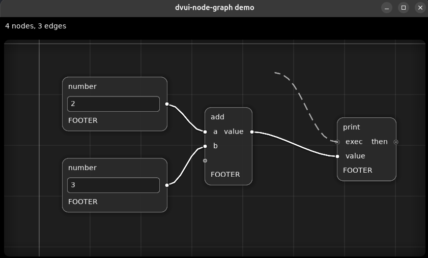

# dvui-node-graph

Node graph editor widgets for [dvui](https://github.com/david-vanderson/dvui)
Developed for [graphl](https://graphl.tech/demo).

This branch is for zig 0.16

> [!WARNING]
> Generative AI was used to edit and/or produce large portions of this code.
> Every source code line was verified by a human.



## Using in your project

Add this project as a dependency:

```sh
zig fetch --save=dvui_node_graph 'git+https://github.com/graphl-tech/dvui-node-graph#master'
```

To use `dvui_node_graph`, you must provide your dvui import. Ensure it is compatible with
the DVUI version that we test under:

```zig
const ng_mod = b.dependency("dvui_node_graph", .{}).module("dvui_node_graph");
// you must add your own DVUI import
ng_mod.addImport("dvui", dvui_module);
```

## Features

- zoomable, pannable graph with grid
- imperative API with managed and unmanaged widgets for your chosen level of flexibility
- DVUI-like high-level graph event API
- imperative selection management
- positive and negative box select
- dashed line effects for edges
- drag or click based node linking
- configurable bezier links

## Example

```zig
const ng = @import("dvui_node_graph");

var positions = [_]dvui.Point{ .{ .x = 20, .y = 40 }, .{ .x = 260, .y = 140 } };
// can change from frame to frame
var input_names: []const []const u8 = &.{ "a", "b" };

// start from the default style and override what you need
var style = ng.Style.default;
style.edge.shadow = null;
style.node.corner_radius = 4;

var graph = ng.graph(@src(), .{ .style = style }, .{});
defer graph.deinit();

// a title and a named row per field
graph.managedNode(@src(), 1, &positions[0], struct { x: f32 }, struct { s: []const u8 }, .{ .title = "one" }, .{});

// node that draws everything itself; its sockets are whatever rows it declares
{
    var node = graph.node(@src(), 2, &positions[1], .{}, .{});
    defer node.deinit();
    {
        var header = node.header(@src(), .{});
        defer header.deinit();
        dvui.label(@src(), "two", .{}, .{});
    }

    {
        var area = node.socketArea(@src(), .{});
        defer area.deinit();
        for (input_names, 0..) |name, i| {
            var row = ng.Input.init(@src(), area, i, .{ .id_extra = i }); // socket .input(i)
            defer row.deinit();
            // anything drawn here is next to the socket
            dvui.label(@src(), "{s}", .{name}, .{});

            for (row.events()) |e| switch (e) {
                .socket => |se| switch (se) {
                    .mouse => |me| switch (me) {
                        .click => |click| std.log.info("clicked at {any}", .{click.p}),
                        .press => {},
                    },
                    .preview_edge => |pe| switch (pe) {
                        .start => {},
                        .connect => |other| std.log.info("linked to {any}", .{other}),
                        .drop => |graph_point| std.log.info("dropped at {any}", .{graph_point}),
                    },
                },
            };
        }
        area.managedOutput(@src(), 0, "out", .{}); // shorthand for an output with just a label
    }
    {
        var footer = node.footer(@src(), .{});
        defer footer.deinit();
        dvui.label(@src(), "below the sockets", .{}, .{});
    }
}

// edges go after the nodes that own their sockets
_ = graph.link(1, .output(0), 2, .input(0)); // node 1's first output -> node 2's first input

for (graph.events()) |e| switch (e) {
    .edge_created => {}, // preview edge released on a compatible socket (opposite sides: output -> input)
    .preview_edge_dropped => {}, // preview edge released on empty canvas, `.point` is graph space
    .edge_clicked => {},
    .nodes_moved => {}, // `.nodes` moved by `.delta`
    // the selection is yours: update it here and pass each node `.selected`
    .select, .select_all, .deselect_all, .box_select => {},
    .delete_selection => {},
    .context_menu => {}, // right click on canvas/node/socket
    else => {},
};
```

Higher level widgets expose the events of the widget it wraps through a variant of
its own event union. e.g. `Input.Event.socket` carries a `SocketWidget.Event`, which splits into
`.mouse` and `.preview_edge`. `SocketWidget` can also be used directly.

## Development

```sh
zig build demo          # interactive SDL3 demo (./examples/demo.zig)
zig build test          # tests
zig build test-images   # tests but writes snapshot PNGs to snapshots/images
```
